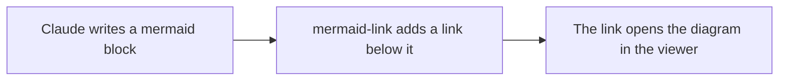

# Beautiful Mermaid Viewer

A live editor for [Mermaid](https://mermaid.js.org) diagrams. You type Mermaid code on the left, and the preview on the right updates as you type.

The live site is at [mermaid.drenther.xyz](https://mermaid.drenther.xyz).

## Features

- Two renderers: [beautiful-mermaid](https://agents.craft.do/mermaid) (SVG and ASCII) and [pele](https://pele.run) (SVG only).
- Light, dark, and system modes, with themes for the diagram and the editor.
- Zoom and pan in the preview.
- Export: download SVG or PNG, or copy SVG, PNG, or ASCII to the clipboard.
- Share links. The diagram goes in the URL fragment, so the browser does not send it to a server.
- A library of saved diagrams, kept in your browser.
- Offline use as a PWA.

## Setup

### Development

You need:

- Node.js 24 or later.
- pnpm 10. Run `corepack enable` to get the version that `package.json` names.
- [portless](https://portless.sh) (`npm install -g portless`). It gives the dev server a named `.localhost` URL.

```sh
pnpm install
pnpm dev                      # https://mermaid-viewer.localhost (port 443, asks for sudo)
PORTLESS_PORT=1355 pnpm dev   # https://mermaid-viewer.localhost:1355 (no sudo)
PORTLESS=0 pnpm dev           # http://localhost:4321 (no portless)
```

| Command        | Result                                          |
| -------------- | ----------------------------------------------- |
| `pnpm build`   | Builds the site into `dist/`.                   |
| `pnpm preview` | Serves the build on a local URL.                |
| `pnpm lint`    | Runs oxlint on `src/` and `claude-plugin/`.     |
| `pnpm format`  | Formats `src/` and `claude-plugin/` with oxfmt. |

The install settings reduce the risk of supply-chain attacks: exact versions, a 7-day minimum release age, and no install scripts. They are in `pnpm-workspace.yaml` and `.npmrc`.

```text
src/
├── components/   # React UI: editor, preview, dialogs, menus
├── renderers/    # adapters for beautiful-mermaid and pele
├── stores/       # app state (XState)
├── themes/       # theme registry and app colors
├── lib/          # share links, clipboard
└── workers/      # share-link compression, off the main thread
claude-plugin/    # the Claude Code plugin (mermaid-link)
.claude-plugin/   # marketplace.json, so that Claude Code can install the plugin from this repo
```

### Claude Code plugin

The `mermaid-link` plugin adds an **Open in mermaid.drenther.xyz ↗** link below each Mermaid diagram that Claude writes.



The link is on your screen only. Claude does not see the link, so it costs no tokens.

To install the plugin in a Claude Code terminal session:

1. Run this command:

   ```
   /plugin install mermaid-link --marketplace drenther/mermaid-viewer
   ```

2. When Claude Code asks to add the marketplace, type `y`.
3. Choose a scope.

To install the plugin in the desktop app:

1. Click **+** next to the prompt box, then click **Plugins**.
2. Click **Add marketplace**, then enter `drenther/mermaid-viewer`.
3. Click **Add plugin**.

If the full URL shows after the link text, set `FORCE_HYPERLINK=1` in your shell. Then restart Claude Code.

> [!NOTE]
> The full URL shows when Claude Code does not find hyperlink support in the terminal. For example, this occurs inside herdr 0.9.2 and later.

For more information, see [`claude-plugin/README.md`](claude-plugin/README.md).
